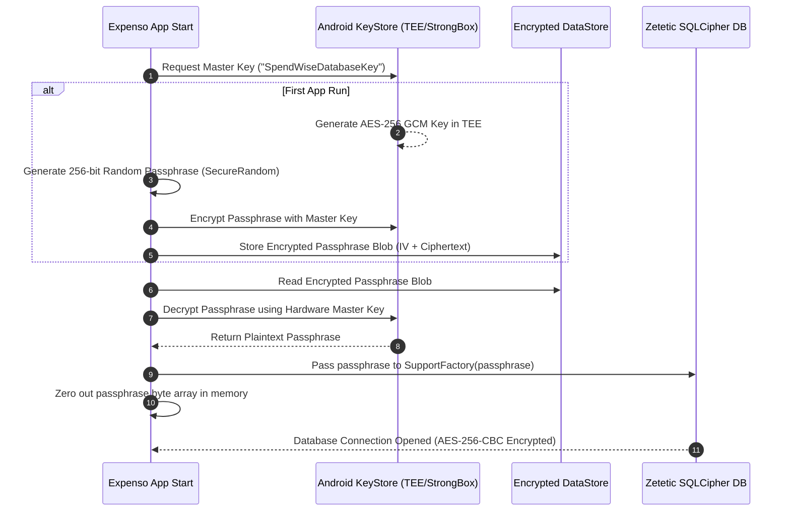
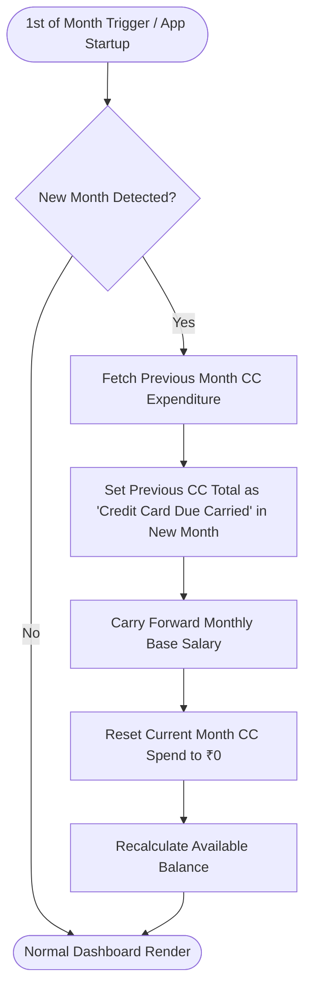
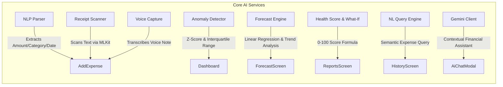
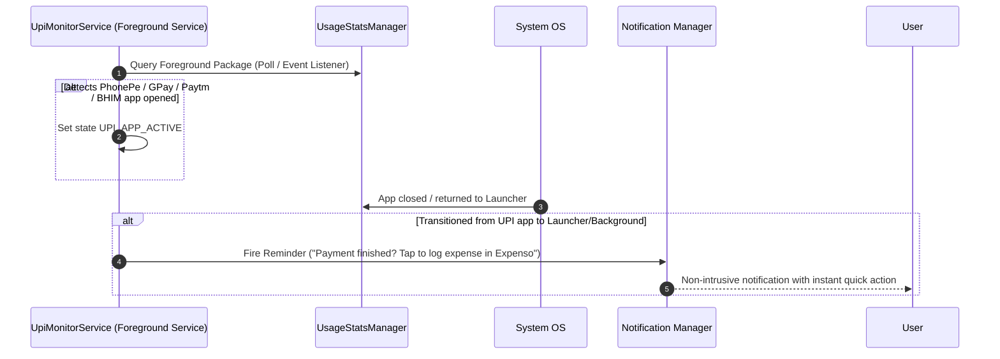

# 🏛 Expenso Architecture & Design Specification

Expenso (SpendWise) is a production-grade, offline-first personal expense tracking application built for **Android 15+ (API 35)**. Designed with complete data sovereignty and zero cloud dependencies by default, Expenso combines **Zetetic SQLCipher hardware-backed AES-256 encryption**, **WhatsApp-style Google Drive encrypted envelope backups**, **Firebase Firestore sync**, and a dedicated **`:intelligence` AI subsystem** powered by on-device ML and Google Gemini.

---

## 📐 1. System Architecture Overview

Expenso follows **Clean Architecture** principles combined with **MVVM (Model-View-ViewModel)** and **Unidirectional Data Flow (UDF)**. The codebase is organized as a multi-module Gradle project:

```mermaid
graph TD
    subgraph UI Layer [UI Layer (Jetpack Compose + Material 3)]
        A[MainActivity / NavGraph] --> B[DashboardScreen]
        A --> C[AddExpenseScreen]
        A --> D[ReportsScreen]
        A --> E[AiForecastScreen]
        A --> F[HistoryScreen]
        A --> G[SettingsScreen]
        A --> H[AiChatModal]
    end

    subgraph Presentation Layer [Presentation Layer]
        B --> ViewModels[DashboardVM / AddExpenseVM / ReportsVM / ForecastVM / ChatVM]
    end

    subgraph Domain Layer [Domain Layer (Use Cases)]
        ViewModels --> UC1[AddExpenseUseCase]
        ViewModels --> UC2[CalculateBalanceUseCase]
        ViewModels --> UC3[GetCategorySpendUseCase]
        ViewModels --> UC4[MonthRolloverUseCase]
        ViewModels --> UC5[ExportDataUseCase]
    end

    subgraph Intelligence Module [:intelligence Submodule]
        ViewModels --> IntelBridge[CapabilityProvider / Intelligence Module]
        IntelBridge --> NLP[NlpExpenseParser]
        IntelBridge --> Anomaly[AnomalyDetector]
        IntelBridge --> Forecast[ForecastEngine]
        IntelBridge --> Health[HealthScoreAndWhatIf]
        IntelBridge --> Query[NlQueryEngine]
        IntelBridge --> Voice[VoiceCaptureEngine]
        IntelBridge --> OCR[ReceiptScanner]
    end

    subgraph Data Layer [Data Layer & Repositories]
        UC1 & UC2 & UC3 & UC4 --> Repos[ExpenseRepo / IncomeRepo / BudgetRepo / CCRepo]
        Repos --> RoomDB[(SQLCipher Room Encrypted DB)]
        Repos --> CloudSync[CloudSyncManager / Firestore]
        Repos --> DriveVault[CloudBackupVaultManager / Google Drive]
    end

    subgraph Security Subsystem [Hardware Security]
        RoomDB <--> KeyProvider[DatabaseKeyProvider]
        KeyProvider <--> AndroidKeyStore[Android KeyStore TEE / StrongBox]
    end
```

---

## 📦 2. Multi-Module Project Structure

The codebase is split into two primary modules to maintain strict dependency boundaries and single-responsibility principles:

| Module | Responsibility | Key Technologies |
|---|---|---|
| **`:app`** | Core Android app containing UI screens, navigation, system services, background workers, encrypted storage, and cloud sync logic. | Jetpack Compose, Navigation Compose, SQLCipher, Hilt, Firebase SDK, Google Drive REST API, WorkManager, BiometricPrompt API. |
| **`:intelligence`** | Standalone Kotlin module implementing 10+ financial AI engines, NLP parsing, MLKit OCR, anomaly detection, forecasting, and health score models. | Kotlin Coroutines, MLKit Text Recognition, Google Gemini REST client, Pure Domain Interfaces (`ExpenseReadApi`, `SalaryReadApi`, etc.). |

---

## 🔒 3. Security Architecture & Threat Model (OWASP MASVS v2.0)

Expenso enforces enterprise-grade security at rest, in transit, in memory, and on screen.

### 3.1 Encryption Flow & Hardware Key Management



### 3.2 Security Controls Summary

- **At-Rest Encryption**: All financial records are stored in SQLite encrypted via Zetetic **SQLCipher 4.6.1** using **AES-256-CBC** with PBKDF2 HMAC-SHA512 derivation (64,000 iterations).
- **Master Key Security**: Database passphrases are sealed inside the hardware-backed **Android KeyStore** (Hardware Security Module / TEE / StrongBox) using `KeyProperties.PURPOSE_ENCRYPT | PURPOSE_DECRYPT` with `AES/GCM/NoPadding`.
- **UI Screen Protection**: `WindowManager.LayoutParams.FLAG_SECURE` is active on `MainActivity`, preventing OS screenshots, screen recordings, and recent app previews.
- **Biometric & Credentials App Lock**: Guarded by AndroidX `BiometricPrompt API` with `BIOMETRIC_STRONG` or `DEVICE_CREDENTIAL` and SHA-256 fallback PIN code. Features customizable auto-lock timeout (default 30s) and backgrounding auto-lock.
- **Zero Internet Core Mode**: Android manifest contains zero mandatory permissions for ad trackers, telemetry, or invasive data collection.

---

## 💳 4. Core Financial Engine & Month Rollover Mathematics

Expenso uses a strict multi-ledger financial algorithm to handle cash, income, credit cards, and automated monthly resets.

### 4.1 Financial Ledger Formulas

$$\text{Available Balance} = \text{Monthly Salary} - \sum \text{Spent}_{\text{Income Source}} - \text{Credit Card Due Carried}$$

$$\text{Current Credit Card Spend} = \sum \text{Spent}_{\text{Credit Card Source (Current Month)}}$$

$$\text{Total Spend} = \sum \text{Spent}_{\text{Income}} + \sum \text{Spent}_{\text{Credit Card}}$$

### 4.2 Month Rollover Workflow

On the 1st of every month (or during app launch via `MonthRolloverWorker`), the rollover execution sequence runs:



---

## ☁️ 5. Cloud Backup & Single Source of Truth Sync

Expenso supports dual cloud operations: private **Google Drive Encrypted Backups** (local-first) and **Firebase Firestore Sync**.

### 5.1 Google Drive Encrypted Envelope Format

Backups stored in the hidden Google Drive `appDataFolder` (`https://www.googleapis.com/auth/drive.appdata`) use a custom binary envelope format:

```
+-------------------------------------------------------------------------+
| Header: "EXPBK01" (7 Bytes ASCII)                                        |
+-------------------------------------------------------------------------+
| Envelope Version: 0x01 (1 Byte)                                         |
+-------------------------------------------------------------------------+
| Encryption Mode: 0x01 (Account-Bound) | 0x02 (Password) | 0x03 (Key)    |
+-------------------------------------------------------------------------+
| Random Salt: 16 Bytes                                                   |
+-------------------------------------------------------------------------+
| Random GCM Initialization Vector (IV): 12 Bytes                         |
+-------------------------------------------------------------------------+
| Payload: Ciphertext + 16-Byte AES-256-GCM Auth Tag (GZIP compressed JSON)|
+-------------------------------------------------------------------------+
```

### 5.2 Firebase Firestore Schema Architecture

```
users/{uid}/
├── meta/profile            ──> { onboardingDone: bool, schemaVersion: int, checksum: str }
├── config/main             ──> { categories: [...], settings: {...} }
└── months/{yyyy-MM}        ──> { salary: double, expensesMap: { id: { amount, note, date, catId } } }
    └── parts/{partIndex}   ──> { overflowExpenses: {...} } (for months with >1800 expenses)
```

---

## 🧠 6. Intelligence & AI Subsystem (`:intelligence`)

The `:intelligence` module provides 10 distinct financial intelligence capability modules:



### 6.1 Capability Breakdown

1. **`NlpExpenseParser`**: Parses natural language inputs like `"Paid 450 for dinner at BBQ Nation yesterday"` into structured expense fields (`amount: 450.0`, `category: "Food"`, `date: Yesterday`).
2. **`ReceiptScanner`**: Uses Google ML Kit Text Recognition to extract merchant names, dates, tax breakdown, and total totals from camera photos or images.
3. **`AnomalyDetector`**: Computes rolling spending standard deviations to flag outlier transactions exceeding expected category thresholds.
4. **`ForecastEngine`**: Applies time-series forecasting to predict end-of-month spend based on current daily spending velocity.
5. **`HealthScoreAndWhatIf`**: Calculates a comprehensive 0-100 Financial Health Index based on savings rate, credit utilization ratio, budget adherence, and recurring bill obligations.
6. **`GeminiClient`**: Connects securely to Google Gemini REST API to power the interactive financial advisor chatbot with localized context summaries.

---

## 🔔 7. UPI Payment Monitoring Background Service

Expenso features an automated, privacy-first background service (`UpiMonitorService`) that detects UPI payment app usage without reading screen contents or financial SMS.



### Privacy Guarantee:
- **No Accessibility Service**: Does not inspect UI elements or read passwords.
- **No SMS Permission**: Does not read transaction SMS messages.
- **Compliance**: Uses Android 15 `FOREGROUND_SERVICE_SPECIAL_USE` with subtype `UPI payment app monitoring for user-triggered expense logging`.

---

## 🛠 8. Database Schema & Data Model

The Room SQLCipher database (`spendwise.db`) consists of 6 primary entities:

```mermaid
erDiagram
    Category ||--o{ Expense : classifies
    IncomeMonth ||--o{ Expense : tracks_in_month
    Category {
        string id PK
        string name
        string iconResName
        long colorHex
        boolean isDefault
    }
    Expense {
        string id PK
        double amount
        string categoryId FK
        long timestamp
        string note
        string paymentSource "INCOME | CREDIT_CARD"
        long createdAt
        long updatedAt
    }
    IncomeMonth {
        string monthKey PK "YYYY-MM"
        double salaryAmount
        double creditCardDueCarried
    }
    Budget {
        string categoryId PK FK
        double monthlyLimit
    }
    CreditCardLedger {
        string id PK
        string monthKey
        double totalSpend
        boolean isSettled
    }
    SyncOutbox {
        string id PK
        string entityType
        string payloadJson
        long timestamp
    }
```

---

## 🏗 9. Build & Deployment Architecture

- **Gradle Build Configuration**: Kotlin DSL (`build.gradle.kts`) with version catalogs.
- **16 KB Page Alignment**: All native `.so` libraries (Zetetic SQLCipher 4.6.1) are pre-aligned to 16 KB memory boundaries to support Android 15 ARM64 and x86_64 devices.
- **Code Shrinking**: ProGuard / R8 rules strip debug loggers (`Log.d`, `Log.v`, `Log.i`) and obfuscate release builds.
